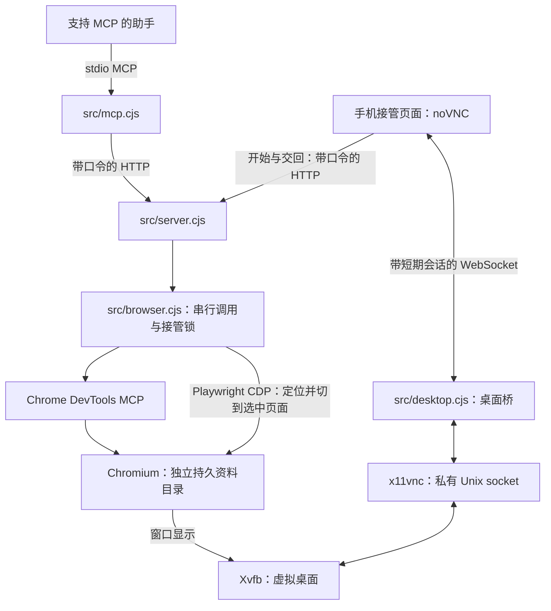
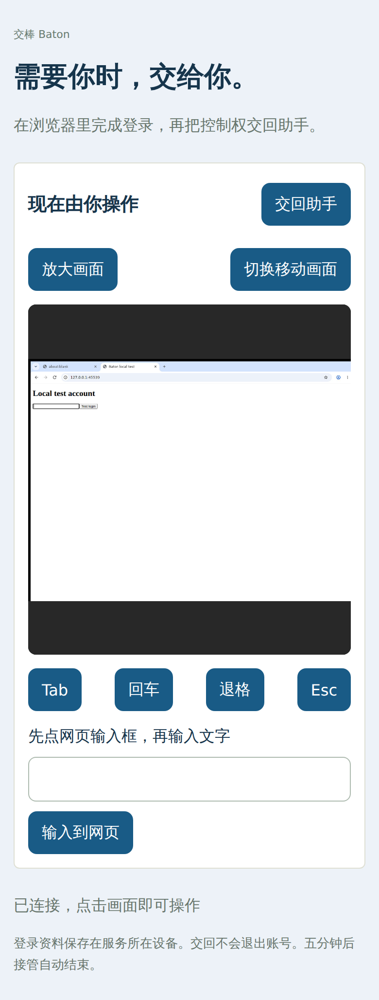

# 整体设计：助手操作，用户接管

Baton 用现有 Chromium 浏览器作为网页执行环境，增加 MCP 接口、持久登录资料和手机接管。它不是新的浏览器内核，不是手机原生 App 控制器。服务运行在 Linux 设备，手机通过网页看到并操作同一个浏览器桌面。

## 整体结构

助手操作网页走 Chrome DevTools MCP；手机操作走远程桌面。这两条路径连接同一个浏览器。Playwright 用于查找 Chromium、连接 CDP 和定位接管页面，并非手机画面实时传输的通道。

## 用户会看到什么

1. 打开接管页面，输入服务口令。
2. 查看浏览器已经打开的网页，选择要接管的页面。
3. 服务切到所选标签页，手机显示整个桌面。支持点击、拖动、放大、移动画面和输入文字。
4. 接管期间，新的助手浏览器调用被拒绝；不自动绕过接管锁。
5. 用户按“交回助手”，或五分钟到期后，释放控制权，助手才能继续调用。

接管从当前串行任务结束后开始，不能撤销之前已执行的点击或提交。选中页面只是切换前台标签页，不能隔离其他窗口。

图中是本地假账号测试页面，不包含真实平台账号。390×780、deviceScaleFactor 2 的手机截图。

## 能力与代码入口

| 部分 | 职责 | 文件 |
| --- | --- | --- |
| MCP 接口 | 工具列表、调用转发、标准 image 截图、提示用户接管 | [src/mcp.cjs](../src/mcp.cjs) |
| HTTP 服务 | API 口令、同源检查、接管页面、WebSocket 挂载 | [src/server.cjs](../src/server.cjs) |
| 浏览器管理 | 按需启动、独立资料目录、串行操作、接管锁、闲置关闭 | [src/browser.cjs](../src/browser.cjs) |
| 桌面桥 | Xvfb 与 x11vnc 生命周期、短期会话校验、桌面转发 | [src/desktop.cjs](../src/desktop.cjs) |
| 网页读取 | 读取最多三页、标记登录或验证、保留失败页面编号 | [src/reader.cjs](../src/reader.cjs) |
| 手机界面 | 选页、连接桌面、输入文字、交回控制权 | [web/app.js](../web/app.js) |

网页操作包括列出/新建/关闭页面、导航、文字快照、截图、点击、填写、按键、悬停、拖动、对话框处理、等待、调整窗口和执行页面脚本。具体参数以上游工具定义为准。`request_takeover` 只提供接管提示，不会替用户启动接管。

## 登录、页面与生命周期

登录资料默认存入运行设备的 `.baton/profile`，不同网站依浏览器规则分别保存 cookie 和存储。账号凭据不保存在公开仓库。登录保留不代表永不过期，也不代表平台所有功能可用。

一套服务默认共用一个浏览器资料目录。助手调用携带明确的 `pageId`，避免猜测当前页面；页面编号约定不是多用户权限隔离。多个不可信用户应使用各自独立部署，不应共用此实例。

接管五分钟自动结束，浏览器十分钟闲置后关闭。关闭保留资料目录；后续调用会再次启动浏览器，但页面需要重新打开。调用失败不会自动重复提交。

## 规则与安全边界

HTTP API 使用服务口令，桌面连接使用短期随机会话，并检查同源；VNC 不监听公开 TCP 端口。手机远程使用要另配 HTTPS 入口，支持 WebSocket 转发。

发送消息、下单等必须按用户指令执行，这目前是提供给助手的使用规则。服务不具备识别每一次点击是否为“付款/发送”的通用审批系统。页面编号也不形成严格的任务所有权隔离。

服务可以执行页面脚本及访问主机可达网页，包含内网；它不是不可信用户的抓取沙箱。更多边界见 [SECURITY.md](../SECURITY.md)，安装限制见 [README.md](../README.md#验证与限制)。

## 实测范围

独立版已经用本地假账号验证 MCP 连接、截图、网页读取、真实桌面接管、接管时助手暂停、交回后继续、远程键盘输入和浏览器重启后登录保留。

这不等于实测所有平台、所有 MCP 客户端或所有部署环境。具体记录见 [VALIDATION.md](VALIDATION.md)。
